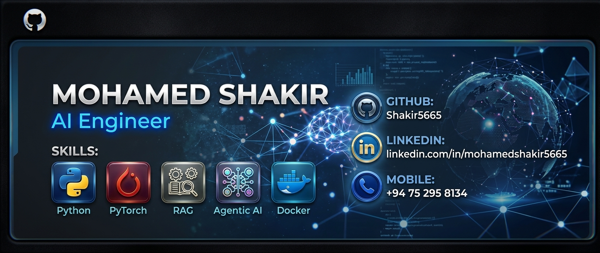

  <!-- Hero Banner -->
  

  <!-- Animated Typing Title -->
  

  

    <strong>Final-Year B.Sc. in IT @ Rajarata University of Sri Lanka • Transforming Ideas into Scalable Solutions</strong>
  

  <!-- Connect Badges -->
  

    
    
    
    
    
  

---

### 🔷 About Me

I am an **AI Engineer & Systems Developer** dedicated to bridging the frontier between state-of-the-art Artificial Intelligence and production-grade software architectures. With a strong foundation in distributed backend engineering and computer science, I specialize in architecting **autonomous AI agents**, high-throughput **Retrieval-Augmented Generation (RAG) pipelines**, and scalable full-stack enterprise systems.

Over the past two years, I have architected and deployed end-to-end software solutions spanning enterprise SaaS, intelligent agentic workflows, and microservice backends. I thrive at taking machine learning innovations out of notebooks and engineering them into resilient, containerized, low-latency applications that create measurable enterprise value.

- **Deep Technical Focus:** Context-aware RAG pipelines, hybrid search, vector embeddings, and semantic routing.
- **Systems Mastery:** Designing robust REST APIs, microservices with Python (FastAPI/Django), Java (Spring Boot), and .NET Core.
- **Open Source & Collaboration:** Active contributor to developer ecosystems, passionate about modular open-source software and transparent AI tooling.
- **Open To:** AI Engineer, Machine Learning Engineer, and Backend Engineering opportunities.

---

### 📊 GitHub Activity & Analytics

  <table border="0">
    <tr>
      <td align="center">
        
      </td>
      <td align="center">
        
      </td>
    </tr>
    <tr>
      <td align="center" colspan="2">
        
      </td>
    </tr>
    <tr>
      <td align="center" colspan="2">
        
      </td>
    </tr>
  </table>

---

### 🔷 Let's Connect & Collaborate

Whether you're looking to discuss autonomous agent architectures, collaborate on an open-source project, or build next-generation enterprise AI solutions, my inbox is always open!

| Channel | Contact Point |
| :--- | :--- |
| 🌐 **Portfolio** | [shakir-portfolio-one-amber-87.vercel.app](https://shakir-portfolio-one-amber-87.vercel.app) |
| 💼 **LinkedIn** | [linkedin.com/in/mohamedshakir5665](https://www.linkedin.com/in/mohamedshakir5665) |
| 📧 **Email** | [mohamedsakir3456@gmail.com](mailto:mohamedsakir3456@gmail.com) |
| 📱 **Direct / WhatsApp** | [+94 75 295 8134](tel:+94752958134) |
| 🐙 **GitHub** | [@Shakir5665](https://github.com/Shakir5665) |

 

> *"Transforming ideas into reliable, scalable, and autonomous production systems."*

